# Press stories (sports-director view)

## R01 — presser: STRONG PRESSURE — LANE LEFT OPEN · team: PRESS PLAYED THROUGH

**May (AUC) on Jackson (MEL)** — Took his time away (1.6m away at release) but the pass went into a lane he didn't cut off.

_Your take (partial):_ Cut off - led to a bad pass, but blue could have made a better pass; up in the air

1. **CONTEXT** — 75' (H2) | MEL 0-1 AUC (AUC leading) | create | ball in MEL's middle third, center
2. **THE PRESS** — Setup: front-on press (goal-side). May closes Jackson: 7.8m -> 1.6m at 2.6 m/s, goal-side. pressing alone; 2 passing options, 0 teammates within 10m.
3. **FORCED RESPONSE** — Plays a sideways left long 39m pass to Clarismario Rodrigues, completed after 2.4s on the ball (1.6m away when ball released).
4. **TEAM OUTCOME** — MEL escape the press (ball moved +34m for MEL); AUC only win it back 6.8s later, deep in their own third. MEL's possession value (EPV) 0.025 -> gone. Ball went: Jackson (long) > Hall (AUC).

_Data checks:_ all passed
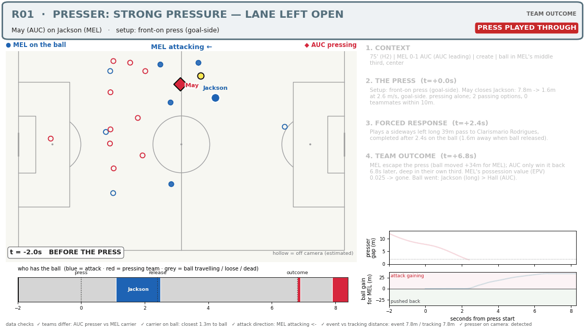

## R02 — presser: SOME PRESSURE · team: FORCED THEM BACKWARDS

**Valadon (MEL) on Gallegos (AUC)** — Got reasonably close (3.5m away at release) without really forcing the carrier.

_Your take (agree):_ Kind of in between

1. **CONTEXT** — 39' (H1) | MEL 0-0 AUC (level) | create | ball in AUC's middle third, wide right
2. **THE PRESS** — Setup: front-on press (goal-side). Valadon closes Gallegos: 8.0m -> 3.6m at 1.4 m/s, goal-side. pressing alone; 2 passing options, 0 teammates within 10m.
3. **FORCED RESPONSE** — Plays a backward short 14m pass to Hall, completed after 3.1s on the ball (3.5m away when ball released).
4. **TEAM OUTCOME** — AUC keep it but go backwards: ball moved -5m for AUC in 8s. AUC's possession value (EPV) 0.028 -> 0.036. Ball went: Gallegos > Hall.

_Data checks:_ all passed
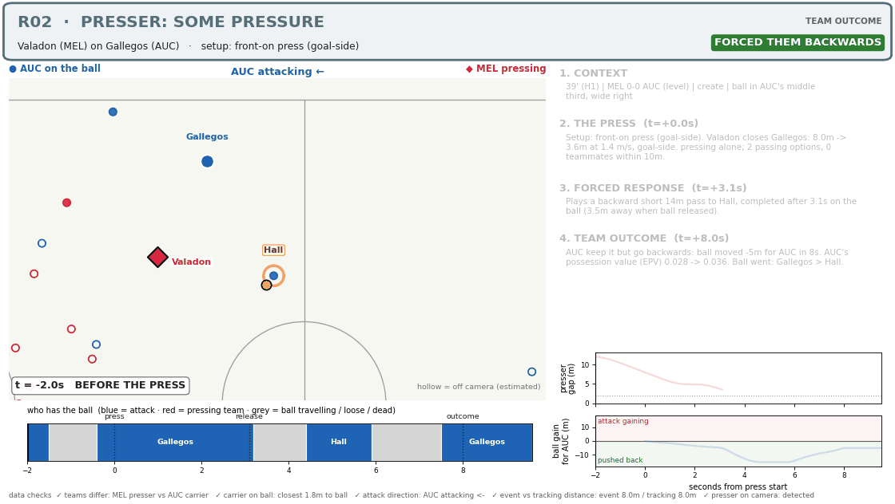

## R03 — presser: STRONG PRESSURE · team: FORCED IT LONG — WON IT BACK

**May (AUC) on Jackson (MEL)** — Took his time away (1.7m away at release) and forced the next action.

_Your take (agree):_ Not cut off, but a good press - pressure forced a bad pass

1. **CONTEXT** — 49' (H2) | MEL 0-0 AUC (level) | build up | ball in MEL's defensive third, wide left
2. **THE PRESS** — Setup: front-on press (goal-side). May closes Jackson: 9.8m -> 1.7m at 5.1 m/s, goal-side. 2-man press (May, Randall); 2 passing options, 0 teammates within 10m.
3. **FORCED RESPONSE** — Plays a sideways right long 32m pass to Hamill, completed after 1.6s on the ball (1.7m away when ball released).
4. **TEAM OUTCOME** — MEL are forced to go long and AUC win the second ball 9.2s after the press, in midfield. MEL's possession value (EPV) 0.019 -> gone. Ball went: Jackson (long) > Hamill > Pijnaker (AUC).

_Data checks:_ all passed
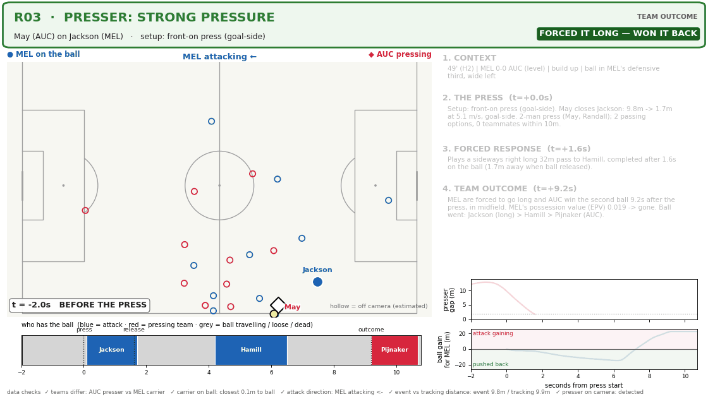

## R04 — presser: OUT OF POSITION FROM THE START · team: CONTAINED — NO DAMAGE, NO WIN

**Randall (AUC) on Valadon (MEL)** — He started 2.3m behind the ball; chasing from behind can't cut the forward lanes.

_Your take (agree):_ Going through the motions; could have played it better

1. **CONTEXT** — 47' (H2) | MEL 0-0 AUC (level) | create | ball in MEL's middle third, center
2. **THE PRESS** — Setup: chasing from behind (not goal-side). Randall closes Valadon: 6.8m -> 2.2m at 1.6 m/s, NOT goal-side. pressing alone; 3 passing options, 1 teammates within 10m.
3. **FORCED RESPONSE** — Plays a sideways right medium 17m pass to Inserra, completed after 2.9s on the ball (5.0m away when ball released).
4. **TEAM OUTCOME** — MEL keep it, no real progress: ball moved +0m for MEL in 8s. MEL's possession value (EPV) 0.033 -> 0.033. Ball went: Valadon > Inserra (long) > Arzani.

_Data checks:_ all passed
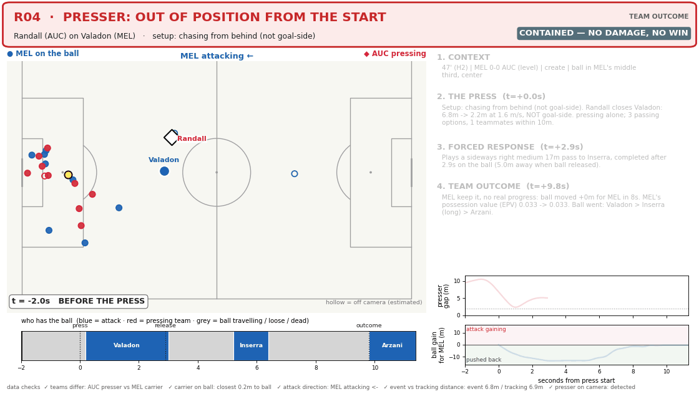

## R05 — presser: WENT THROUGH THE MOTIONS · team: CONTAINED — NO DAMAGE, NO WIN

**Moreno (AUC) on Velupillay (MEL)** — Ran at it but was 5.2m away at release; nothing forced.

_Your take (agree):_ Could have closed the gaps better

1. **CONTEXT** — 76' (H2) | MEL 0-1 AUC (AUC leading) | create | ball in MEL's middle third, wide right
2. **THE PRESS** — Setup: front-on press (goal-side). Moreno closes Velupillay: 5.3m -> 4.5m at 1.9 m/s, goal-side. pressing alone; 4 passing options, 1 teammates within 10m.
3. **FORCED RESPONSE** — Plays a sideways left long 33m pass to Duncan, completed after 0.4s on the ball (5.2m away when ball released).
4. **TEAM OUTCOME** — MEL keep it, no real progress: ball moved +6m for MEL in 8s. MEL's possession value (EPV) 0.023 -> 0.034. Ball went: Velupillay (long) > Duncan > Bos.

_Data checks:_ all passed
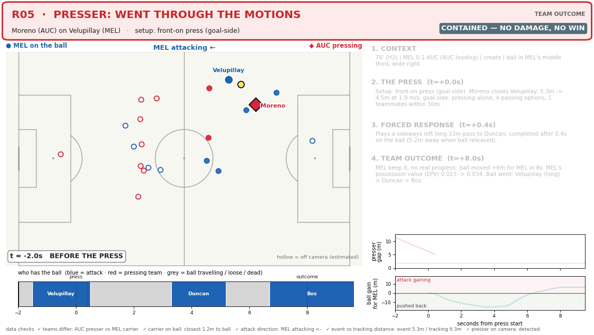

## R06 — presser: OUT OF POSITION FROM THE START · team: PRESS PLAYED THROUGH

**May (AUC) on Valadon (MEL)** — He started 4.7m behind the ball; chasing from behind can't cut the forward lanes.

_Your take (agree):_ Hard to call this a press since he's behind

1. **CONTEXT** — 86' (H2) | MEL 0-1 AUC (AUC leading) | create | ball in MEL's middle third, center
2. **THE PRESS** — Setup: chasing from behind (not goal-side). May closes Valadon: 4.7m -> 2.6m at 1.5 m/s, NOT goal-side. 2-man press (Verstraete, May); 5 passing options, 1 teammates within 10m.
3. **FORCED RESPONSE** — Plays a sideways right short 12m pass to Piscopo, completed after 1.4s on the ball (2.5m away when ball released).
4. **TEAM OUTCOME** — MEL keep it and escape: ball moved +36m for MEL in 8s, beyond the presser. MEL's possession value (EPV) 0.030 -> 0.058. Ball went: Valadon > Piscopo (long) > Inserra.

_Data checks:_ all passed
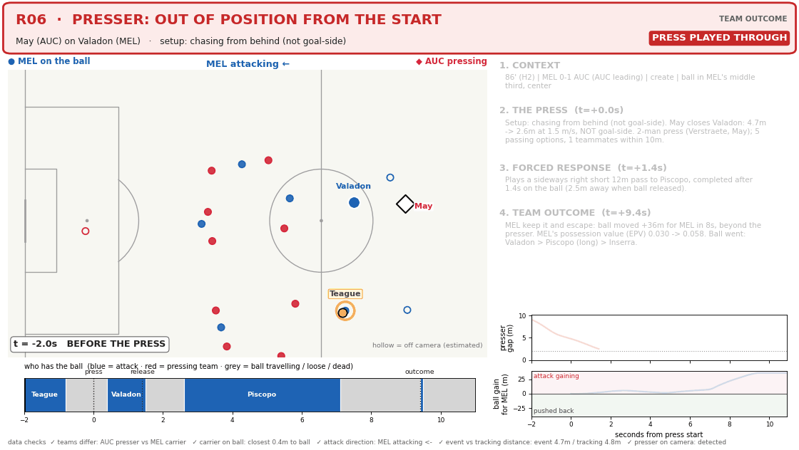

## R07 — presser: OUT OF POSITION FROM THE START · team: PRESS PLAYED THROUGH

**Vergos (MEL) on May (AUC)** — He started 5.7m behind the ball; chasing from behind can't cut the forward lanes.

_Your take (agree):_ Same deal - not the best positioning to start

1. **CONTEXT** — 62' (H2) | MEL 0-0 AUC (level) | build up | ball in AUC's defensive third, wide right
2. **THE PRESS** — Setup: chasing from behind (not goal-side). Vergos closes May: 4.2m -> 1.6m at 1.5 m/s, NOT goal-side. 2-man press (Vergos, Arzani); 4 passing options, 2 teammates within 10m.
3. **FORCED RESPONSE** — Plays a sideways left medium 29m pass to De Vries, completed after 1.7s on the ball (1.6m away when ball released).
4. **TEAM OUTCOME** — AUC keep it and escape: ball moved +13m for AUC in 8s, beyond the presser. AUC's possession value (EPV) 0.020 -> 0.037. Ball went: May > De Vries > Gillion.

_Data checks:_ warning — event vs tracking distance (event 4.2m / tracking 5.8m); presser on camera (estimated position)
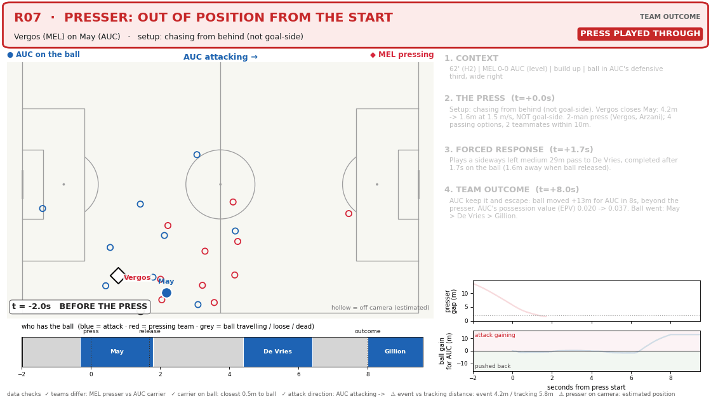

## R08 — presser: STRONG PRESSURE · team: FORCED IT OUT OF PLAY

**May (AUC) on Duncan (MEL)** — Took his time away (8.3m away at release) and forced the next action.

_Your take (agree):_ Good press

1. **CONTEXT** — 10' (H1) | MEL 0-0 AUC (level) | build up | ball in MEL's defensive third, center
2. **THE PRESS** — Setup: front-on press (goal-side). May closes Duncan: 9.5m -> 8.2m at 6.2 m/s, goal-side. pressing alone; 1 passing options, 0 teammates within 10m.
3. **FORCED RESPONSE** — Forced to clear it after 0.2s on the ball (8.3m away when ball released).
4. **TEAM OUTCOME** — Ball goes out 3.3s later — AUC restart (throw in). MEL's possession value (EPV) 0.019 -> gone. Ball went: Duncan (clears) > AUC restart (AUC).

_Data checks:_ all passed
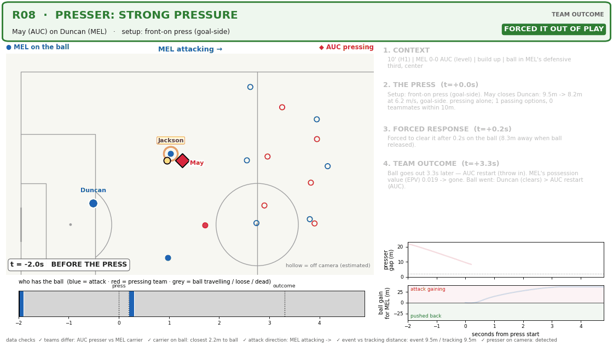

## R09 — presser: TEAM PRESS — LITTLE PERSONAL PRESSURE · team: FORCED IT LONG — WON IT BACK

**Machach (MEL) on Paulsen (AUC)** — Good team outcome, but he was 6.6m away at release; the run may have closed an option (Lane Tax will tell).

_Your take (partial):_ Another good press

1. **CONTEXT** — 5' (H1) | MEL 0-0 AUC (level) | direct | ball in AUC's defensive third, center
2. **THE PRESS** — Setup: front-on press (goal-side). Machach closes Paulsen: 9.8m -> 6.6m at 2.5 m/s, goal-side. pressing alone; 2 passing options, 0 teammates within 10m.
3. **FORCED RESPONSE** — Plays a forward long 38m pass to Rogerson, completed after 1.3s on the ball (6.6m away when ball released).
4. **TEAM OUTCOME** — AUC are forced to go long and MEL win the second ball 3.8s after the press, in midfield. AUC's possession value (EPV) 0.019 -> gone. Ball went: Paulsen (long) > Jackson (MEL).

_Data checks:_ all passed
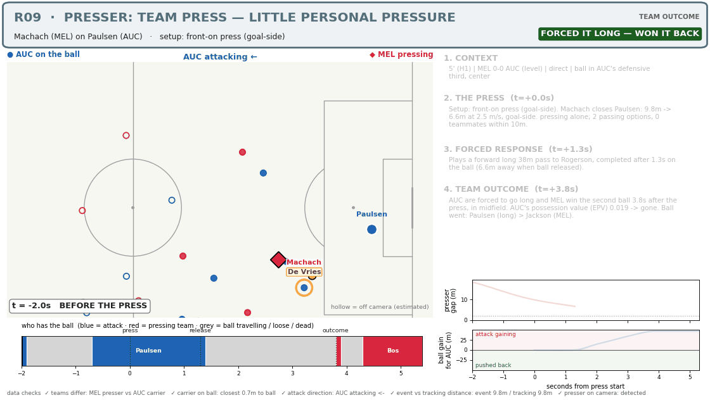

## R10 — presser: OUT OF POSITION FROM THE START · team: PRESS PLAYED THROUGH

**May (AUC) on Valadon (MEL)** — He started 4.6m behind the ball; chasing from behind can't cut the forward lanes.

_Your take (agree):_ Not going through the motions - just bad positioning to start

1. **CONTEXT** — 67' (H2) | MEL 0-1 AUC (AUC leading) | create | ball in MEL's defensive third, center
2. **THE PRESS** — Setup: chasing from behind (not goal-side). May closes Valadon: 5.5m -> 0.9m at 1.7 m/s, NOT goal-side. 6-man press (Moreno, Gillion, Verstraete, May, De Vries, Gallegos); 5 passing options, 2 teammates within 10m.
3. **FORCED RESPONSE** — Plays a sideways right medium 28m pass to Arzani, completed after 2.8s on the ball (1.2m away when ball released).
4. **TEAM OUTCOME** — MEL keep it and escape: ball moved +14m for MEL in 8s, beyond the presser. MEL's possession value (EPV) 0.034 -> 0.024. Ball went: Valadon > Arzani > Inserra (long).

_Data checks:_ all passed
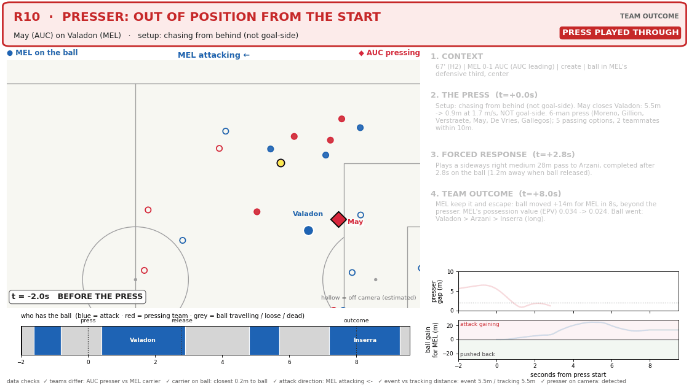

## R11 — presser: CHASED BACK — IT WORKED · team: WON IT BACK

**Teague (MEL) on May (AUC)** — He started 4.1m behind the ball, but the chase plus 3 teammates nearby forced the outcome.

_Your take (agree):_ Good press

1. **CONTEXT** — 92' (H2) | MEL 0-1 AUC (MEL trailing) | create | ball in AUC's middle third, wide right
2. **THE PRESS** — Setup: chasing from behind (not goal-side). Teague closes May: 5.4m -> 0.5m at 1.7 m/s, NOT goal-side. 3-man press (Badolato, Bos, Teague); 5 passing options, 3 teammates within 10m.
3. **FORCED RESPONSE** — Tries a pass to Verstraete, NOT completed after 2.8s on the ball (2.5m away when ball released).
4. **TEAM OUTCOME** — MEL win it back 3.9s after the press (Badolato), in midfield. AUC's possession value (EPV) 0.029 -> gone. Ball went: May > Badolato (MEL).

_Data checks:_ all passed
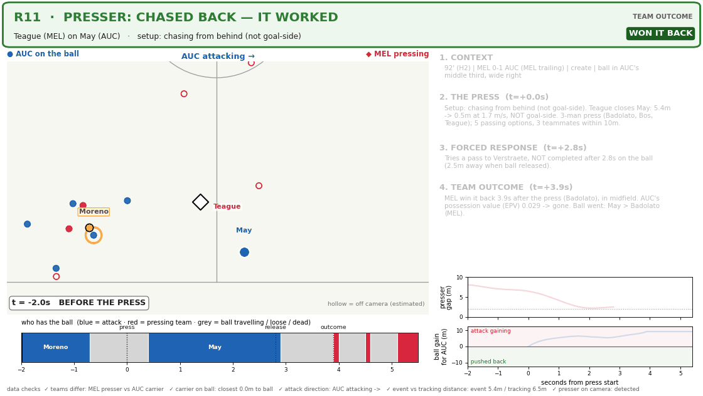

## R12 — presser: SOME PRESSURE · team: CONTAINED — NO DAMAGE, NO WIN

**Teague (MEL) on May (AUC)** — Got reasonably close (3.9m away at release) without really forcing the carrier.

_Your take (partial):_ Hard to judge - he had so many options around him

1. **CONTEXT** — 37' (H1) | MEL 0-0 AUC (level) | create | ball in AUC's middle third, center
2. **THE PRESS** — Setup: front-on press (goal-side). Teague closes May: 6.0m -> 3.9m at 1.1 m/s, goal-side. pressing alone; 2 passing options, 2 teammates within 10m.
3. **FORCED RESPONSE** — Plays a sideways left medium 17m pass to Pijnaker, completed after 1.9s on the ball (3.9m away when ball released).
4. **TEAM OUTCOME** — AUC keep it, no real progress: ball moved +8m for AUC in 8s. AUC's possession value (EPV) 0.033 -> 0.027. Ball went: May > Pijnaker > De Vries > Gallegos.

_Data checks:_ all passed
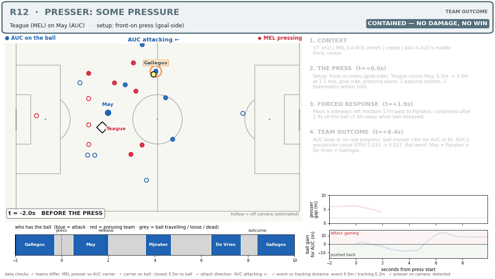

## R13 — presser: NOT A REAL PRESS · team: PRESS PLAYED THROUGH

**Randall (AUC) on Valadon (MEL)** — Closed at 0.0 m/s and stayed 5.0m away — shouldn't count as a press.

_Your take (agree):_ Barely a press

1. **CONTEXT** — 52' (H2) | MEL 0-0 AUC (level) | create | ball in MEL's middle third, wide left
2. **THE PRESS** — Setup: not a real press (never closed). Randall closes Valadon: 5.0m -> 5.0m at 0.0 m/s, NOT goal-side. pressing alone; 3 passing options, 4 teammates within 10m.
3. **FORCED RESPONSE** — Plays a sideways right medium 28m pass to Inserra, completed after 2.0s on the ball (6.6m away when ball released).
4. **TEAM OUTCOME** — MEL escape the press (ball moved +31m for MEL); AUC only win it back 7.6s later, deep in their own third. MEL's possession value (EPV) 0.023 -> gone. Ball went: Valadon > Inserra > Hall (AUC).

_Data checks:_ all passed
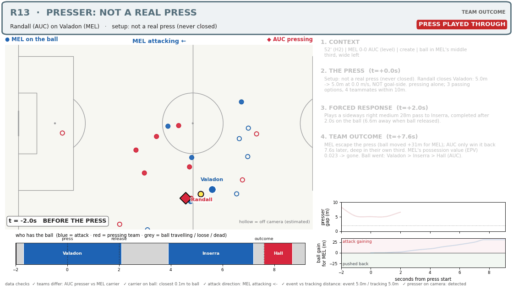

## R14 — presser: PRESS ENDED IN A FOUL · team: PRESS GAVE AWAY A FOUL

**Gallegos (AUC) on Machach (MEL)** — The press nearly won it, but a foul handed the ball straight back (1.5m away at release).

_Your take (agree):_ Fouled and still almost got it to his teammate - not a good press

1. **CONTEXT** — 3' (H1) | MEL 0-0 AUC (level) | create | ball in MEL's middle third, center
2. **THE PRESS** — Setup: front-on press (goal-side). Gallegos closes Machach: 7.6m -> 0.9m at 2.1 m/s, goal-side. 3-man press (Rogerson, Verstraete, Gallegos); 3 passing options, 3 teammates within 10m.
3. **FORCED RESPONSE** — Loses the ball under pressure after 3.2s on the ball (1.5m away when ball released).
4. **TEAM OUTCOME** — Press ends in a free kick for MEL after 3.2s. MEL's possession value (EPV) 0.031 -> 0.046. Ball went: Machach.

_Data checks:_ all passed
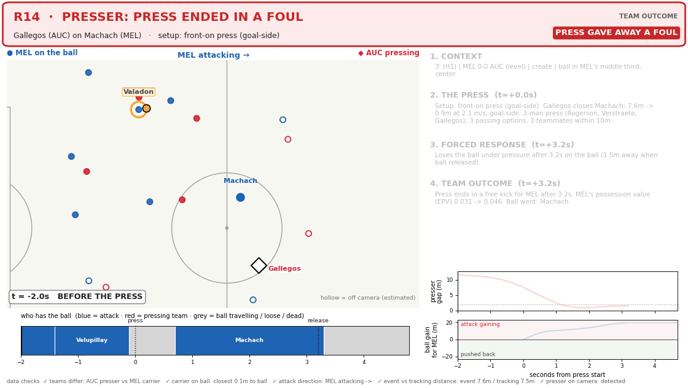

## R15 — presser: CUT THE LANE — INTERCEPTED · team: WON IT BACK — PRESSER HIMSELF

**Gallegos (AUC) on Inserra (MEL)** — Didn't need to close: stood in the passing lane (4.6m away at release) and the pass came to him.

_Your take (disagree):_ Didn't win it back by his press - the diamond just had good positioning

1. **CONTEXT** — 41' (H1) | MEL 0-0 AUC (level) | create | ball in MEL's middle third, wide right
2. **THE PRESS** — Setup: positional — holds the lane, doesn't close. Gallegos closes Inserra: 3.6m -> 3.6m at 0.0 m/s, goal-side. 4-man press (Randall, De Vries, Gallegos, Francois); 2 passing options, 2 teammates within 10m.
3. **FORCED RESPONSE** — Tries a pass to Arzani, NOT completed after 0.9s on the ball (4.6m away when ball released).
4. **TEAM OUTCOME** — AUC win it back 1.5s after the press (Gallegos), deep in their own third. MEL's possession value (EPV) 0.029 -> gone. Ball went: Inserra > Gallegos (AUC).

_Data checks:_ all passed
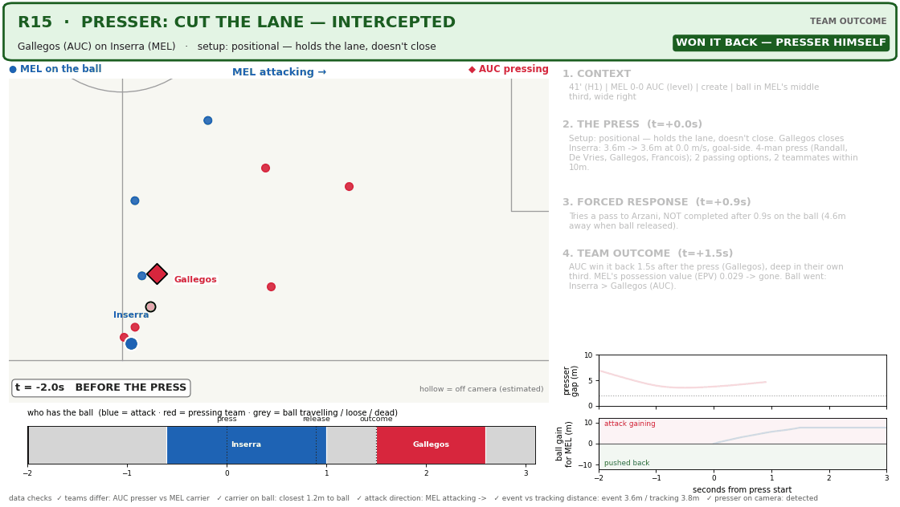
