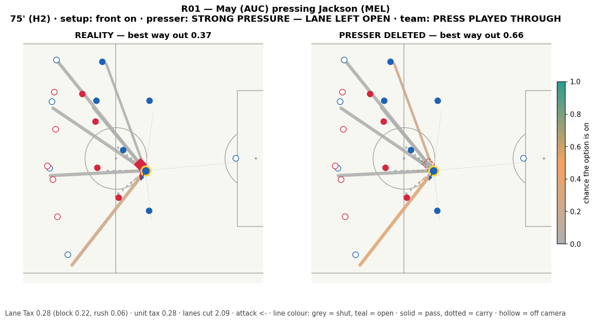
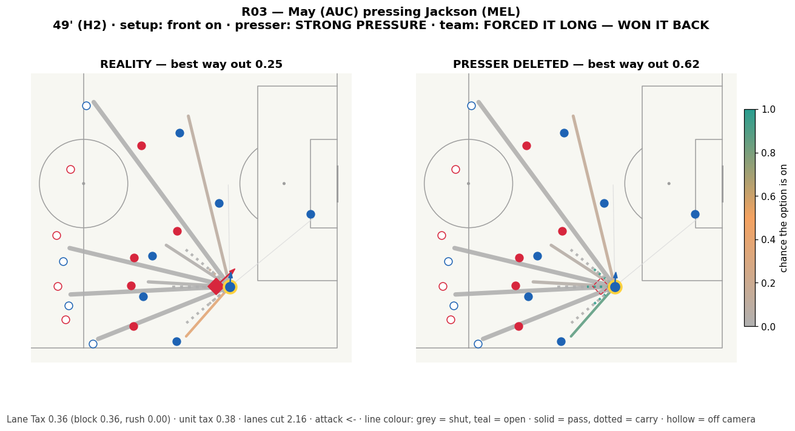
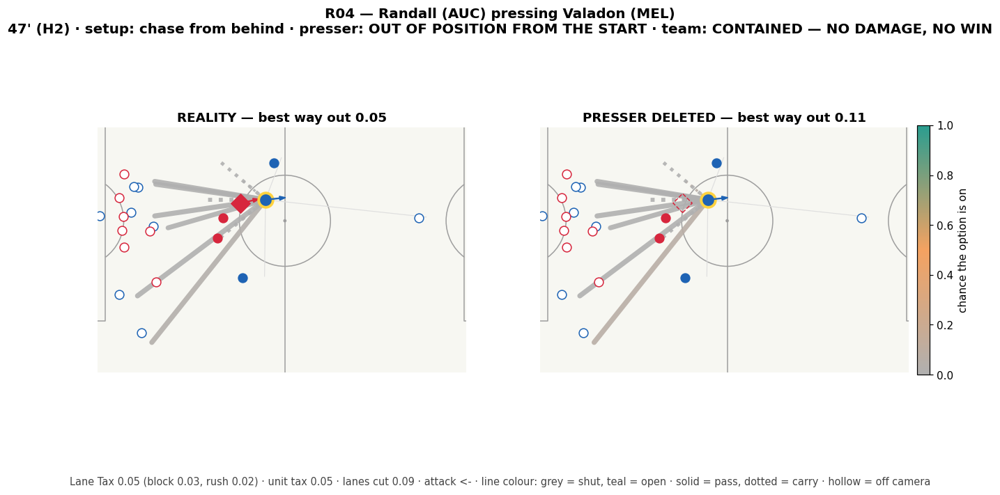
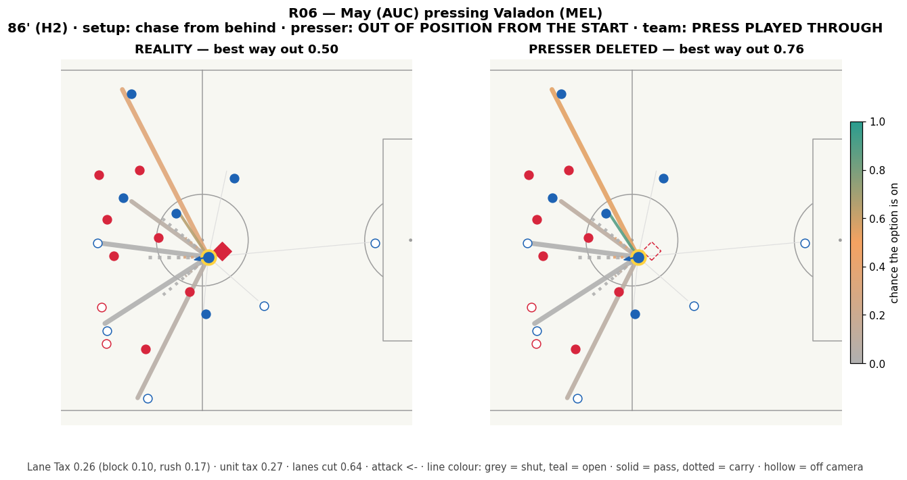
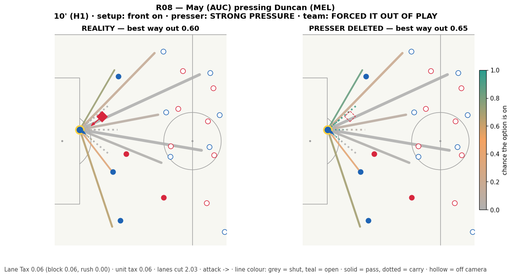
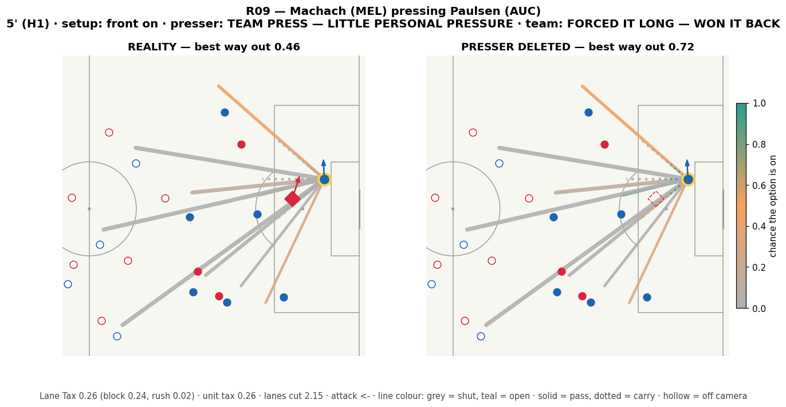
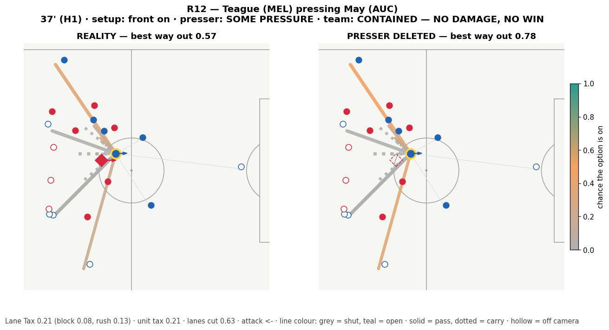
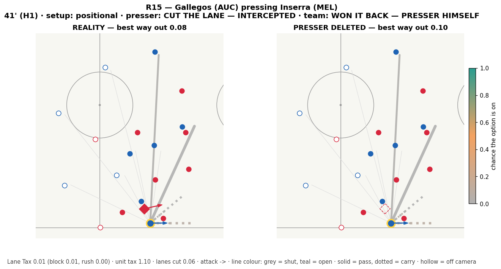

# Phase 2 — Lane Tax on match 2017461

> **One match, in-sample.** Nothing here is fitted, but the constants were sanity-checked on this match,
> so these numbers are a smoke test. The real test is Phase 3: all matches, held out.

- Presses scored: **279** (3 flagged *not a real press* and left out of the tests below)
- Median Lane Tax 0.14; top quarter above 0.30
- Our 'is this pass on?' vs SkillCorner xPass on 2022 of their passing options: Spearman **0.72**
- Higher Lane Tax -> carrier ends up playing a lower-xPass pass? Spearman 0.06 (n=243; negative = yes)

## Does it separate presses that worked from ones that didn't?

AUC = if you pick one press that worked and one that didn't, how often the score ranks the one that worked
higher. 0.50 is a coin flip. Brackets are 95% bootstrap intervals.

### team outcome good (story engine, ~8 s)  (n=276, worked=109)

| score | AUC | 95% interval |
|---|---|---|
| SkillCorner fewer options ahead | 0.65 | 0.58–0.71 |
| TEAM: ways out left (fewer = higher) **(tax)** | 0.61 | 0.54–0.67 |
| TEAM: best way out left (fewer = higher) **(tax)** | 0.61 | 0.54–0.67 |
| SkillCorner fewer passing options | 0.57 | 0.50–0.64 |
| Opponents within 5 m | 0.57 | 0.50–0.63 |
| TEAM: pressing-chain tax **(tax)** | 0.55 | 0.48–0.61 |
| Closing speed | 0.54 | 0.46–0.61 |
| SkillCorner pressure band | 0.53 | 0.45–0.59 |
| Nearest opponent | 0.52 | 0.45–0.59 |
| Presser gap (closer = higher) | 0.52 | 0.45–0.58 |
| Lane Tax (presser, peak) **(tax)** | 0.52 | 0.45–0.59 |
| TEAM: total squeeze from defenders near the ball **(tax)** | 0.51 | 0.44–0.58 |
| Lane Tax — block part **(tax)** | 0.51 | 0.44–0.58 |
| Presser time-to-carrier | 0.51 | 0.44–0.58 |
| Trap tax (presser) **(tax)** | 0.50 | 0.43–0.57 |
| Lane Tax (presser, at release) **(tax)** | 0.50 | 0.42–0.57 |
| Lane Tax (presser, 1 s in) **(tax)** | 0.50 | 0.43–0.57 |
| SkillCorner option ease (harder = higher) | 0.49 | 0.42–0.56 |
| Ways-out tax (presser) **(tax)** | 0.47 | 0.40–0.54 |
| Lanes cut (presser, every lane) **(tax)** | 0.45 | 0.38–0.52 |
| Lane Tax — rush part **(tax)** | 0.40 | 0.34–0.46 |

### attack did NOT escape under control within 4 s  (n=276, worked=192)

| score | AUC | 95% interval |
|---|---|---|
| SkillCorner fewer options ahead | 0.66 | 0.60–0.72 |
| TEAM: ways out left (fewer = higher) **(tax)** | 0.65 | 0.58–0.72 |
| TEAM: best way out left (fewer = higher) **(tax)** | 0.63 | 0.56–0.70 |
| Presser time-to-carrier | 0.56 | 0.48–0.64 |
| Opponents within 5 m | 0.55 | 0.48–0.62 |
| Presser gap (closer = higher) | 0.54 | 0.47–0.62 |
| Ways-out tax (presser) **(tax)** | 0.53 | 0.46–0.59 |
| TEAM: pressing-chain tax **(tax)** | 0.52 | 0.44–0.60 |
| Lane Tax (presser, peak) **(tax)** | 0.52 | 0.45–0.59 |
| Trap tax (presser) **(tax)** | 0.52 | 0.45–0.59 |
| Nearest opponent | 0.51 | 0.44–0.59 |
| SkillCorner fewer passing options | 0.50 | 0.43–0.57 |
| Lane Tax (presser, at release) **(tax)** | 0.50 | 0.42–0.56 |
| Lane Tax — rush part **(tax)** | 0.49 | 0.42–0.56 |
| SkillCorner pressure band | 0.49 | 0.42–0.56 |
| Lane Tax — block part **(tax)** | 0.49 | 0.42–0.56 |
| Lane Tax (presser, 1 s in) **(tax)** | 0.48 | 0.42–0.55 |
| Closing speed | 0.47 | 0.39–0.55 |
| TEAM: total squeeze from defenders near the ball **(tax)** | 0.47 | 0.40–0.55 |
| SkillCorner option ease (harder = higher) | 0.46 | 0.38–0.52 |
| Lanes cut (presser, every lane) **(tax)** | 0.44 | 0.37–0.51 |

### SkillCorner says the press forced back / reduced / stopped danger  (n=276, worked=17)

| score | AUC | 95% interval |
|---|---|---|
| Presser gap (closer = higher) | 0.71 | 0.58–0.82 |
| Presser time-to-carrier | 0.68 | 0.54–0.79 |
| Lane Tax (presser, peak) **(tax)** | 0.66 | 0.52–0.81 |
| Lane Tax (presser, 1 s in) **(tax)** | 0.64 | 0.50–0.77 |
| Nearest opponent | 0.61 | 0.46–0.75 |
| Lane Tax — block part **(tax)** | 0.61 | 0.48–0.74 |
| Ways-out tax (presser) **(tax)** | 0.60 | 0.46–0.73 |
| Lane Tax (presser, at release) **(tax)** | 0.60 | 0.46–0.73 |
| SkillCorner fewer options ahead | 0.60 | 0.45–0.73 |
| TEAM: pressing-chain tax **(tax)** | 0.59 | 0.45–0.75 |
| TEAM: ways out left (fewer = higher) **(tax)** | 0.59 | 0.47–0.72 |
| TEAM: total squeeze from defenders near the ball **(tax)** | 0.58 | 0.44–0.73 |
| Opponents within 5 m | 0.55 | 0.46–0.65 |
| Trap tax (presser) **(tax)** | 0.55 | 0.41–0.67 |
| TEAM: best way out left (fewer = higher) **(tax)** | 0.55 | 0.42–0.68 |
| SkillCorner fewer passing options | 0.53 | 0.41–0.66 |
| Lanes cut (presser, every lane) **(tax)** | 0.52 | 0.38–0.65 |
| Lane Tax — rush part **(tax)** | 0.49 | 0.36–0.63 |
| Closing speed | 0.44 | 0.31–0.58 |
| SkillCorner option ease (harder = higher) | 0.37 | 0.23–0.50 |
| SkillCorner pressure band | 0.36 | 0.21–0.52 |

### carrier's response was a failed pass, a loss or a clearance  (n=276, worked=62)

| score | AUC | 95% interval |
|---|---|---|
| SkillCorner option ease (harder = higher) | 0.63 | 0.56–0.71 |
| TEAM: ways out left (fewer = higher) **(tax)** | 0.60 | 0.52–0.68 |
| TEAM: best way out left (fewer = higher) **(tax)** | 0.60 | 0.52–0.68 |
| SkillCorner pressure band | 0.58 | 0.50–0.66 |
| Opponents within 5 m | 0.58 | 0.50–0.65 |
| Nearest opponent | 0.58 | 0.49–0.66 |
| Presser gap (closer = higher) | 0.57 | 0.48–0.65 |
| TEAM: pressing-chain tax **(tax)** | 0.57 | 0.48–0.65 |
| TEAM: total squeeze from defenders near the ball **(tax)** | 0.57 | 0.49–0.64 |
| Presser time-to-carrier | 0.55 | 0.45–0.62 |
| Trap tax (presser) **(tax)** | 0.54 | 0.45–0.63 |
| Lane Tax — block part **(tax)** | 0.52 | 0.44–0.61 |
| SkillCorner fewer passing options | 0.52 | 0.44–0.60 |
| Lane Tax (presser, at release) **(tax)** | 0.51 | 0.43–0.60 |
| Lane Tax (presser, peak) **(tax)** | 0.51 | 0.42–0.60 |
| Ways-out tax (presser) **(tax)** | 0.49 | 0.41–0.58 |
| Closing speed | 0.49 | 0.41–0.58 |
| Lane Tax (presser, 1 s in) **(tax)** | 0.49 | 0.40–0.57 |
| SkillCorner fewer options ahead | 0.48 | 0.41–0.56 |
| Lanes cut (presser, every lane) **(tax)** | 0.45 | 0.37–0.53 |
| Lane Tax — rush part **(tax)** | 0.43 | 0.36–0.51 |

### press team won it back within 5 s  (n=276, worked=56)

| score | AUC | 95% interval |
|---|---|---|
| Closing speed | 0.61 | 0.52–0.69 |
| SkillCorner fewer passing options | 0.57 | 0.48–0.66 |
| SkillCorner option ease (harder = higher) | 0.56 | 0.48–0.64 |
| TEAM: best way out left (fewer = higher) **(tax)** | 0.56 | 0.47–0.65 |
| TEAM: ways out left (fewer = higher) **(tax)** | 0.56 | 0.47–0.64 |
| Trap tax (presser) **(tax)** | 0.54 | 0.46–0.63 |
| SkillCorner pressure band | 0.53 | 0.44–0.61 |
| Opponents within 5 m | 0.52 | 0.44–0.61 |
| SkillCorner fewer options ahead | 0.52 | 0.44–0.60 |
| Lane Tax — block part **(tax)** | 0.51 | 0.42–0.60 |
| TEAM: total squeeze from defenders near the ball **(tax)** | 0.50 | 0.42–0.60 |
| Lane Tax (presser, at release) **(tax)** | 0.49 | 0.41–0.58 |
| Lanes cut (presser, every lane) **(tax)** | 0.48 | 0.39–0.56 |
| Ways-out tax (presser) **(tax)** | 0.47 | 0.38–0.56 |
| Presser gap (closer = higher) | 0.46 | 0.37–0.54 |
| Nearest opponent | 0.45 | 0.36–0.54 |
| Presser time-to-carrier | 0.45 | 0.37–0.54 |
| Lane Tax (presser, 1 s in) **(tax)** | 0.45 | 0.37–0.53 |
| Lane Tax (presser, peak) **(tax)** | 0.44 | 0.35–0.53 |
| TEAM: pressing-chain tax **(tax)** | 0.43 | 0.35–0.52 |
| Lane Tax — rush part **(tax)** | 0.43 | 0.37–0.50 |

## Our scores vs the best simple baseline (same presses, paired bootstrap)

| label | score | best_baseline | auc_gain | ci_lo | ci_hi |
|---|---|---|---|---|---|
| y_press_success | TEAM: ways out left (fewer = higher) | SkillCorner fewer options ahead | -0.04 | -0.12 | 0.04 |
| y_press_success | TEAM: best way out left (fewer = higher) | SkillCorner fewer options ahead | -0.04 | -0.12 | 0.04 |
| y_press_success | Lane Tax (presser, at release) | SkillCorner fewer options ahead | -0.15 | -0.24 | -0.05 |
| y_contained | TEAM: ways out left (fewer = higher) | SkillCorner fewer options ahead | -0.01 | -0.09 | 0.07 |
| y_contained | TEAM: best way out left (fewer = higher) | SkillCorner fewer options ahead | -0.03 | -0.11 | 0.05 |
| y_contained | Lane Tax (presser, at release) | SkillCorner fewer options ahead | -0.16 | -0.25 | -0.07 |
| y_sc_effect | TEAM: ways out left (fewer = higher) | Presser gap (closer = higher) | -0.12 | -0.28 | 0.07 |
| y_sc_effect | TEAM: best way out left (fewer = higher) | Presser gap (closer = higher) | -0.16 | -0.34 | 0.02 |
| y_sc_effect | Lane Tax (presser, at release) | Presser gap (closer = higher) | -0.11 | -0.30 | 0.06 |
| y_forced_error | TEAM: ways out left (fewer = higher) | SkillCorner option ease (harder = higher) | -0.02 | -0.10 | 0.07 |
| y_forced_error | TEAM: best way out left (fewer = higher) | SkillCorner option ease (harder = higher) | -0.02 | -0.10 | 0.06 |
| y_forced_error | Lane Tax (presser, at release) | SkillCorner option ease (harder = higher) | -0.11 | -0.23 | 0.02 |
| y_regain | TEAM: ways out left (fewer = higher) | Closing speed | -0.05 | -0.19 | 0.08 |
| y_regain | TEAM: best way out left (fewer = higher) | Closing speed | -0.05 | -0.18 | 0.09 |
| y_regain | Lane Tax (presser, at release) | Closing speed | -0.11 | -0.23 | 0.01 |

## Among presses at the same distance, does the tax still tell them apart?

AUC within presser-gap terciles (so 'he was just closer' is taken out).

| label | neg_ways_out | neg_escape | squeeze_total | lane_tax | ways_tax | b_opponents_within_5m | b_sc_pressure | b_sc_fewer_options_ahead |
|---|---|---|---|---|---|---|---|---|
| y_press_success | 0.61 | 0.60 | 0.52 | 0.50 | 0.48 | 0.56 | 0.52 | 0.64 |
| y_contained | 0.66 | 0.64 | 0.47 | 0.51 | 0.54 | 0.52 | 0.49 | 0.65 |
| y_sc_effect | 0.57 | 0.52 | 0.54 | 0.58 | 0.56 | 0.51 | 0.30 | 0.67 |
| y_forced_error | 0.58 | 0.58 | 0.55 | 0.51 | 0.48 | 0.55 | 0.56 | 0.47 |
| y_regain | 0.57 | 0.58 | 0.52 | 0.52 | 0.49 | 0.52 | 0.54 | 0.54 |

## 'Looks like a press, tax says no' (15 presses)

Presser within 2.5 m at release, but bottom-quarter Lane Tax: close, yet the carrier still had a way out.

| clock | presser | press_team | carrier | press_type | presser_verdict | outcome | lane_tax | credit_share | top_squeezer | escape | b_presser_gap | best_option | y_contained |
|---|---|---|---|---|---|---|---|---|---|---|---|---|---|
| 35' (H1) | Gallegos | AUC | Machach | chase_from_behind | CHASED BACK — IT WORKED | won_fast | 0.00 | 0.01 | L. Verstraete | 0.02 | -2.33 | pass:progressive:11885 | 1 |
| 72' (H2) | Teague | MEL | Verstraete | front_on | SOME PRESSURE | forced_out | 0.00 | 0.01 | L. Jackson | 0.01 | -1.87 | carry:carry:6 | 0 |
| 38' (H1) | Randall | AUC | Valadon | chase_from_behind | CHASED BACK — IT WORKED | forced_out | 0.01 | 0.04 | L. Rogerson | 0.02 | -2.11 | pass:progressive:50955 | 1 |
| 32' (H1) | Bos | MEL | May | front_on | PRESS ENDED IN A FOUL | foul_given | 0.01 | 0.05 | J. Valadon | 0.04 | -2.03 | pass:progressive:133501 | 1 |
| 7' (H1) | Randall | AUC | Teague | chase_from_behind | OUT OF POSITION FROM THE START | played_through | 0.01 | 0.02 | L. Verstraete | 0.08 | -1.84 | pass:progressive:811820 | 0 |
| 66' (H2) | Arzani | MEL | Moreno | chase_from_behind | OUT OF POSITION FROM THE START | played_through | 0.01 | 0.03 | R. Teague | 0.12 | -2.01 | pass:progressive:38673 | 0 |
| 12' (H1) | Rogerson | AUC | Valadon | chase_from_behind | CHASED BACK — IT WORKED | forced_out | 0.02 | 0.16 | L. Verstraete | 0.00 | -1.89 | carry:carry:6 | 1 |
| 3' (H1) | Gallegos | AUC | Machach | front_on | PRESS ENDED IN A FOUL | foul_given | 0.02 | 0.06 | L. Verstraete | 0.29 | -1.42 | pass:progressive:29075 | 0 |
| 52' (H2) | Francois | AUC | Machach | chase_from_behind | OUT OF POSITION FROM THE START | played_through | 0.02 | 0.17 | J. Randall | 0.20 | -1.73 | pass:progressive:11885 | 1 |
| 41' (H1) | De Vries | AUC | Arzani | front_on | STRONG PRESSURE — LANE LEFT OPEN | played_through | 0.02 | 0.44 | F. De Vries | 0.09 | -0.85 | pass:switch:811820 | 1 |
| 12' (H1) | May | AUC | Arzani | front_on | SOME PRESSURE | played_through | 0.03 | 0.12 | J. Randall | 0.11 | -2.37 | pass:progressive:811820 | 1 |
| 74' (H2) | Gallegos | AUC | Clarismario Rodrigues | chase_from_behind | PRESS ENDED IN A FOUL | foul_given | 0.03 | 0.07 | F. De Vries | 0.11 | -1.99 | pass:progressive:50979 | 0 |

## 'Quiet press' (18 presses)

Presser 5 m+ away but top-quarter Lane Tax: he took the lane without getting tight.

| clock | presser | press_team | carrier | press_type | presser_verdict | outcome | lane_tax | credit_share | top_squeezer | escape | b_presser_gap | best_option | y_contained |
|---|---|---|---|---|---|---|---|---|---|---|---|---|---|
| 32' (H1) | Velupillay | MEL | Sakai | front_on | PRESS ENDED IN A FOUL | foul_given | 0.87 | 0.77 | N. Velupillay | 0.08 | -6.05 | pass:progressive:23418 | 0 |
| 12' (H1) | Francois | AUC | Inserra | front_on | TEAM PRESS — LITTLE PERSONAL PRESSURE | forced_back | 0.57 | 0.66 | M. Francois | 0.07 | -5.58 | pass:progressive:157294 | 1 |
| 26' (H1) | Vergos | MEL | Hall | front_on | WENT THROUGH THE MOTIONS | contained | 0.56 | 0.58 | N. Vergos | 0.15 | -6.81 | carry:carry:6 | 1 |
| 12' (H1) | Randall | AUC | Jackson | front_on | SOME PRESSURE | contained | 0.53 | 1.00 | J. Randall | 0.22 | -5.32 | pass:progressive:800322 | 0 |
| 11' (H1) | Velupillay | MEL | Sakai | front_on | WENT THROUGH THE MOTIONS | played_through | 0.52 | 0.54 | N. Velupillay | 0.04 | -5.18 | pass:progressive:582974 | 0 |
| 92' (H2) | Verstraete | AUC | Jackson | front_on | WENT THROUGH THE MOTIONS | played_through | 0.51 | 0.45 | L. Verstraete | 0.12 | -5.90 | pass:progressive:811820 | 0 |
| 23' (H1) | Velupillay | MEL | Sakai | front_on | STRONG PRESSURE | contained | 0.51 | 0.88 | N. Velupillay | 0.08 | -5.86 | carry:carry:6 | 1 |
| 90' (H2) | Clarismario Rodrigues | MEL | Smith | front_on | WENT THROUGH THE MOTIONS | played_through | 0.50 | 1.00 | C. Santos Rodrigues | 0.07 | -5.33 | pass:progressive:14736 | 0 |
| 0' (H1) | Rogerson | AUC | Bos | front_on | TEAM PRESS — LITTLE PERSONAL PRESSURE | won_by_presser | 0.49 | 1.00 | L. Rogerson | 0.67 | -6.88 | pass:progressive:11885 | 1 |
| 5' (H1) | Rogerson | AUC | Velupillay | chase_from_behind | CHASED BACK — IT WORKED | won_fast | 0.46 | 0.45 | L. Rogerson | 0.06 | -11.70 | pass:progressive:11117 | 1 |
| 53' (H2) | May | AUC | Hamill | front_on | TEAM PRESS — LITTLE PERSONAL PRESSURE | won_fast | 0.43 | 1.00 | G. May Bartesaghi | 0.31 | -5.62 | pass:progressive:800322 | 1 |
| 67' (H2) | Rogerson | AUC | Bos | front_on | WENT THROUGH THE MOTIONS | played_through | 0.41 | 0.94 | L. Rogerson | 0.13 | -5.11 | pass:progressive:50955 | 1 |

## Who takes lanes away (pressers with 4+ presses)

| presser | press_team | presses | lanes_cut | mean_lane_tax | mean_credit_share | mean_unit_tax | mean_gap_m | success_rate | contained_rate |
|---|---|---|---|---|---|---|---|---|---|
| Velupillay | MEL | 11 | 11.25 | 0.33 | 0.60 | 0.54 | 5.42 | 0.36 | 0.64 |
| De Vries | AUC | 8 | 5.36 | 0.32 | 0.62 | 0.61 | 4.00 | 0.62 | 0.75 |
| Rogerson | AUC | 16 | 17.90 | 0.29 | 0.68 | 0.47 | 4.91 | 0.50 | 0.75 |
| Francois | AUC | 20 | 18.59 | 0.26 | 0.58 | 0.46 | 4.14 | 0.60 | 0.80 |
| Randall | AUC | 36 | 36.49 | 0.20 | 0.59 | 0.39 | 4.24 | 0.36 | 0.72 |
| May | AUC | 31 | 41.15 | 0.20 | 0.67 | 0.33 | 4.15 | 0.32 | 0.74 |
| Machach | MEL | 11 | 10.05 | 0.19 | 0.52 | 0.39 | 4.13 | 0.36 | 0.64 |
| Gillion | AUC | 8 | 8.60 | 0.19 | 0.64 | 0.43 | 3.28 | 0.12 | 0.88 |
| Verstraete | AUC | 19 | 9.99 | 0.16 | 0.38 | 0.31 | 4.21 | 0.37 | 0.63 |
| Vergos | MEL | 11 | 5.39 | 0.16 | 0.39 | 0.43 | 3.92 | 0.36 | 0.91 |
| Teague | MEL | 12 | 4.58 | 0.15 | 0.33 | 0.36 | 3.17 | 0.42 | 0.67 |
| Bos | MEL | 14 | 6.67 | 0.15 | 0.42 | 0.46 | 4.75 | 0.29 | 0.71 |
| Arzani | MEL | 7 | 4.54 | 0.13 | 0.38 | 0.43 | 3.08 | 0.29 | 0.57 |
| Moreno | AUC | 11 | 8.72 | 0.12 | 0.53 | 0.21 | 4.57 | 0.27 | 0.46 |
| Valadon | MEL | 18 | 8.53 | 0.12 | 0.34 | 0.38 | 3.36 | 0.28 | 0.50 |

## Your 15 reviewed presses

| review_id | press_type | outcome | escape_no_presser | escape | ways_out | lane_tax | lane_tax_rush | ways_tax | credit_share | top_squeezer | unit_tax | trap_tax | your_take |
|---|---|---|---|---|---|---|---|---|---|---|---|---|---|
| R01 | front_on | played_through | 0.66 | 0.37 | 0.43 | 0.28 | 0.06 | 0.54 | 1.00 | G. May Bartesaghi | 0.28 | 0.27 | Cut off - led to a bad pass, but blue could have made a better pass; up in the air |
| R02 | front_on | forced_back | 0.62 | 0.16 | 0.22 | 0.46 | 0.00 | 0.71 | 0.35 | N. Velupillay | 0.46 | 0.08 | Kind of in between |
| R03 | front_on | forced_long_won | 0.62 | 0.25 | 0.41 | 0.36 | 0.00 | 0.57 | 1.00 | G. May Bartesaghi | 0.38 | 0.32 | Not cut off, but a good press - pressure forced a bad pass |
| R04 | chase_from_behind | contained | 0.11 | 0.05 | 0.03 | 0.05 | 0.02 | 0.06 | 0.81 | J. Randall | 0.05 | 0.12 | Going through the motions; could have played it better |
| R05 | front_on | contained | 0.43 | 0.38 | 0.47 | 0.05 | 0.00 | 0.16 | 0.22 | L. Gillion | 0.05 | 0.01 | Could have closed the gaps better |
| R06 | chase_from_behind | played_through | 0.76 | 0.50 | 0.79 | 0.26 | 0.17 | 0.13 | 1.00 | G. May Bartesaghi | 0.27 | 0.25 | Hard to call this a press since he's behind |
| R07 | chase_from_behind | played_through | 0.37 | 0.31 | 0.27 | 0.06 | 0.02 | 0.06 | 0.50 | N. Vergos | 0.06 | 0.32 | Same deal - not the best positioning to start |
| R08 | front_on | forced_out | 0.65 | 0.60 | 0.93 | 0.06 | 0.00 | 0.06 | 0.69 | G. May Bartesaghi | 0.06 | 0.28 | Good press |
| R09 | front_on | forced_long_won | 0.72 | 0.46 | 0.79 | 0.26 | 0.02 | 0.21 | 0.47 | N. Velupillay | 0.26 | 0.36 | Another good press |
| R10 | chase_from_behind | played_through | 0.67 | 0.39 | 0.35 | 0.28 | 0.14 | 0.48 | 0.99 | G. May Bartesaghi | 0.67 | 0.14 | Not going through the motions - just bad positioning to start |
| R11 | chase_from_behind | won_fast | 0.32 | 0.03 | 0.04 | 0.29 | 0.00 | 0.33 | 0.82 | R. Teague | 0.39 | 0.07 | Good press |
| R12 | front_on | contained | 0.78 | 0.57 | 0.71 | 0.21 | 0.13 | 0.16 | 0.66 | R. Teague | 0.21 | 0.11 | Hard to judge - he had so many options around him |
| R13 | not_a_press | played_through | 0.53 | 0.52 | 0.80 | 0.00 | 0.00 | 0.00 | 0.01 | L. Verstraete | 0.00 | 0.00 | Barely a press |
| R14 | front_on | foul_given | 0.31 | 0.29 | 0.33 | 0.02 | 0.00 | 0.08 | 0.06 | L. Verstraete | 0.36 | 0.02 | Fouled and still almost got it to his teammate - not a good press |
| R15 | positional | won_by_presser | 0.10 | 0.08 | 0.14 | 0.01 | 0.00 | 0.05 | 0.02 | F. De Vries | 1.10 | 0.44 | Didn't win it back by his press - the diamond just had good positioning |

## Lane maps

